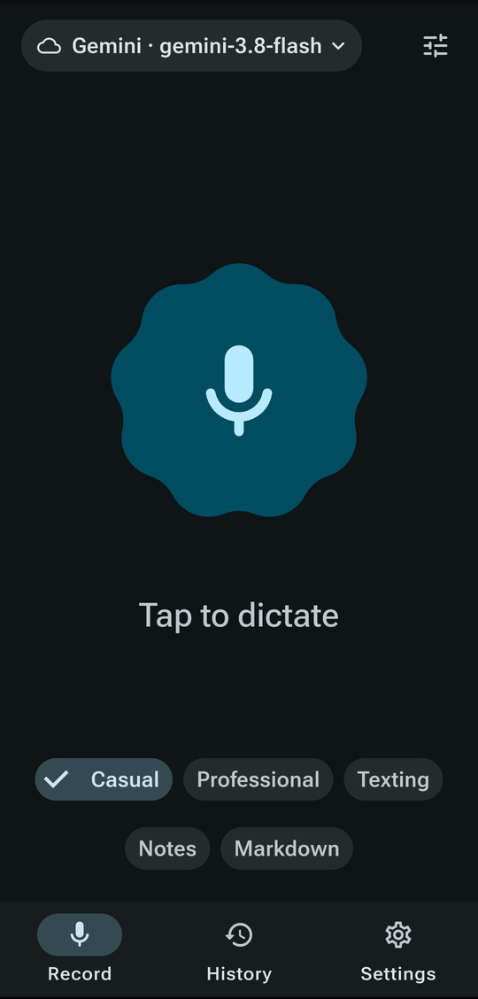
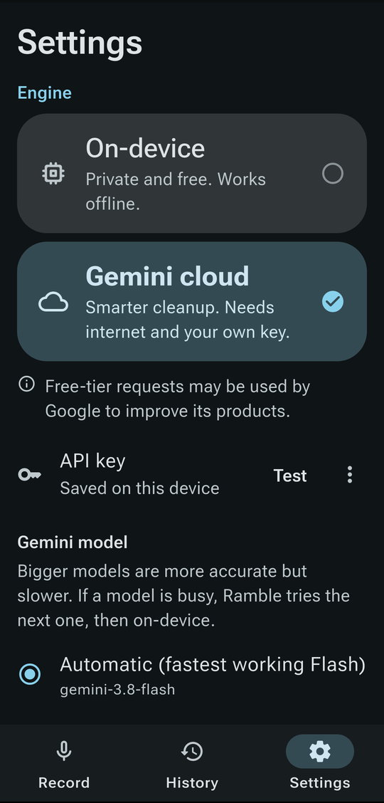
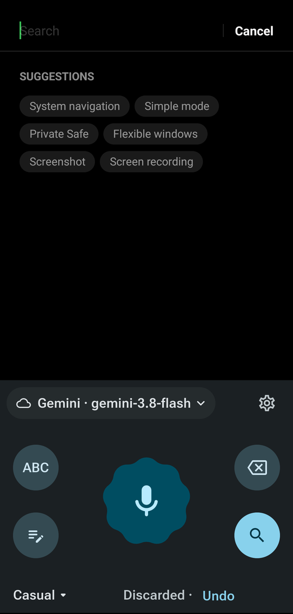

# Ramble Voice

Speak a messy ramble. A voice-native language model hears the audio and returns
clean text, written in your style. Runs on Android 16+ and Linux.

Ramble Voice is text-only: it never executes commands, and spoken instructions
are transcribed, not obeyed. There is no backend, no telemetry and no analytics.
Nothing leaves your device except Gemini requests, and only if you turn on cloud
mode.

License: GPL-3.0-or-later. Repository: <https://github.com/luohoa97/ramble-voice>

## Screenshots

These are placeholders. The image files do not exist yet.

| Home | Listening | Settings |
|---|---|---|
|  |  |  |

| Android keyboard | Linux overlay |
|---|---|
|  |  |

## Features

- Dictate freely, with pauses, false starts and filler words, and get clean text.
- On-device by default with Gemma 4. Your audio never leaves the phone or PC.
- Optional Gemini cloud mode with your own free API key. If Gemini is rate
  limited, offline or out of quota, the app falls back to the on-device model
  when it is downloaded.
- Long recordings: Gemma 4 accepts 30 seconds of audio per request, so audio is
  split at silences (about 28 seconds) and the results are stitched together.
- Android: a keyboard with hold-to-talk, a processing state, text inserted
  directly into the focused field, and a quick switch back to your previous
  keyboard.
- Linux: global hold-to-talk hotkey, text insertion into the focused app,
  an overlay, and a tray icon, depending on your desktop (see the matrix below).
- GPU acceleration when available: OpenCL on Android (Snapdragon and Adreno
  work), Vulkan on Linux with a real vendor driver, otherwise CPU.

## Platform support

Android: Android 16 or newer (API 36), arm64-v8a only.

Linux uses a custom GTK4 runner. Legend: "verified" means tested on real
hardware by the maintainer. "Expected" means it should work from how the
desktop is built, but nobody has tested it yet. Reports are welcome, please use
the Platform report issue template.

| Desktop and session | Hotkey | Text insertion | Overlay | Tray |
|---|---|---|---|---|
| GNOME 50, Wayland, x86_64 | verified (GlobalShortcuts portal) | verified (RemoteDesktop portal) | notification only, no layer-shell on GNOME | verified (needs AppIndicator extension) |
| GNOME, X11 | expected | expected (xdotool) | notification only | expected |
| KDE Plasma, Wayland | expected (GlobalShortcuts portal) | expected (RemoteDesktop portal) | expected (layer-shell) | expected |
| KDE Plasma, X11 | expected | expected (xdotool) | expected | expected |
| Hyprland, Wayland | expected (GlobalShortcuts portal) | expected (wtype) | expected (layer-shell) | expected |
| Sway, Wayland | expected, via compositor binding to `--start` and `--stop` | expected (wtype) | expected (layer-shell) | expected |

Details, fallbacks and config snippets are in
[docs/platform-support.md](docs/platform-support.md). When no insertion method
works, the text is copied to the clipboard and a notification is shown.

## Privacy

- No backend, no telemetry, no analytics, no accounts.
- Audio and text stay on your device in on-device mode.
- The only network traffic is: downloading model weights from Hugging Face
  (once, verified by SHA-256), and Gemini requests when you enable cloud mode.
- In cloud mode your audio is sent to Google's Gemini API using your own key.
  On the free tier, Google may use content to improve its products and human
  reviewers may read it (users in the EEA, UK and Switzerland get paid-tier
  terms). The app shows this warning: "Free-tier requests may be used by Google
  to improve its products."
- Your API key is stored in the platform secret store (libsecret on Linux,
  Android Keystore-backed storage on Android).

More in [docs/PRIVACY.md](docs/PRIVACY.md).

## Setup

Choose one engine in Settings. You can set up both.

### Option A: on-device (default)

1. Open Settings, then Engine.
2. Pick a model and tap Download.
3. Wait for the download and verification to finish. Then dictate.

| Model | Download size | Recommended free RAM |
|---|---|---|
| Gemma 4 E4B (recommended) | 3.66 GB | about 6 GB |
| Gemma 4 E2B | 2.59 GB | about 4 GB |

The RAM figures are our own estimates. Weights come from the ungated
litert-community repositories on Hugging Face (Apache-2.0), are downloaded at
runtime, are checked against a SHA-256 hash, and are never part of this
repository.

### Option B: Gemini cloud

1. Go to <https://aistudio.google.com> and sign in.
2. Choose Get API key, then Create API key, and copy the key.
3. Open Settings in Ramble Voice, paste the key, and tap Test key.

The app lists the models available to your key and always uses the newest
`gemini-*-flash-lite` generation.

Warning: free-tier requests may be used by Google to improve its products, and
human reviewers may read them. Do not dictate anything you would not want
Google to see.

On Linux you can also provide the key through the `GEMINI_API_KEY` environment
variable. It takes precedence over a stored key.

```sh
# Fish
set -Ux GEMINI_API_KEY your_key

# Bash
echo 'export GEMINI_API_KEY=your_key' >> ~/.bashrc

# Zsh
echo 'export GEMINI_API_KEY=your_key' >> ~/.zshrc
```

For the Flatpak, set it with an override:

```sh
flatpak override --user --env=GEMINI_API_KEY=your_key io.github.luohoa97.RambleVoice
```

Note that this stores the key in plain text in the override file.

## Install

Download files from the
[Releases](https://github.com/luohoa97/ramble-voice/releases) page and compare
them with `SHA256SUMS`.

Linux (Flatpak, x86_64 and aarch64):

```sh
flatpak install --user ramble-voice-x86_64.flatpak
flatpak run io.github.luohoa97.RambleVoice
```

Android: install the APK (`ramble-voice-arm64-v8a.apk`), then enable
Ramble Voice under Settings, System, Keyboard, On-screen keyboard. If a release
APK is named `-debug-signed`, it was not signed with the project's release key.

Optional host helper for the ydotool text insertion route:
`packaging/linux/host-setup.sh` (see [docs/platform-support.md](docs/platform-support.md)).

## Build from source

Ramble Voice needs Flutter 3.47.7.

### Linux

Flutter's Linux embedding is GTK3 only, so Ramble Voice has its own GTK4 runner
on the Flutter Embedder API. The Flutter engine binaries come from
[ardera/flutter-ci](https://github.com/ardera/flutter-ci) and are pinned by
SHA-256.

Fedora:

```sh
sudo dnf install clang cmake ninja-build pkgconf-pkg-config gtk4-devel \
  gtk4-layer-shell-devel pipewire-devel pulseaudio-libs-devel libsecret-devel \
  libepoxy-devel
```

Ubuntu 24.10 or newer:

```sh
sudo apt install clang cmake ninja-build pkg-config libgtk-4-dev \
  libgtk4-layer-shell-dev libpipewire-0.3-dev libpulse-dev libsecret-1-dev \
  libepoxy-dev
```

Ubuntu 24.04 does not package gtk4-layer-shell. Build it from source
(<https://github.com/wmww/gtk4-layer-shell>) or build without the overlay.

Then:

```sh
flutter pub get
linux/fetch_engine.sh x86_64 release   # or aarch64
flutter build linux --release
```

The bundle is in `build/linux/<arch>/release/bundle/`.

### Android

Requirements: Flutter 3.47.7, JDK 17, Android SDK 36.

```sh
flutter pub get
flutter build apk --release --split-per-abi
```

The arm64-v8a APK is in `build/app/outputs/flutter-apk/`.

## Contributing

See [CONTRIBUTING.md](CONTRIBUTING.md), [docs/ARCHITECTURE.md](docs/ARCHITECTURE.md)
and the [Code of Conduct](CODE_OF_CONDUCT.md). Report vulnerabilities as
described in [SECURITY.md](SECURITY.md).

## License

Ramble Voice is licensed under GPL-3.0-or-later, see [LICENSE](LICENSE) and
[NOTICE](NOTICE) for third-party components.

The Gemma model weights are not part of this project. They are downloaded at
runtime from Hugging Face and are licensed by Google under the Apache License
2.0, not under the GPL.
